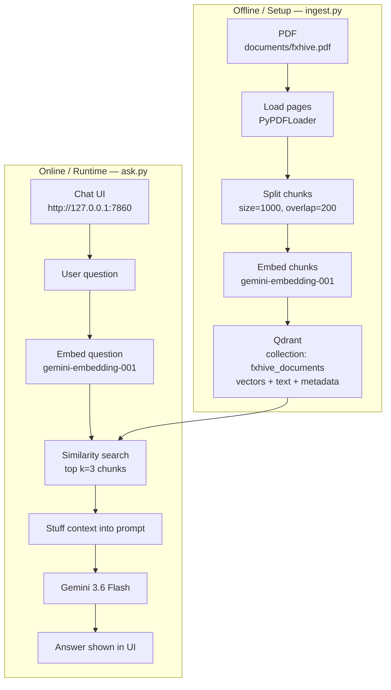
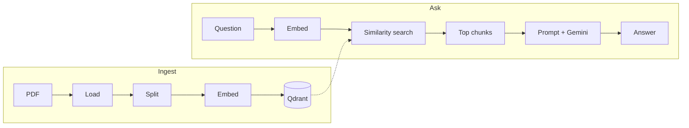
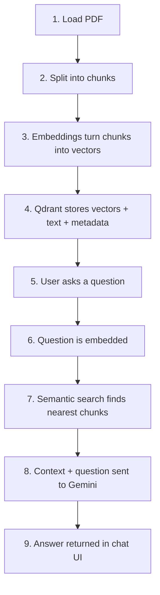
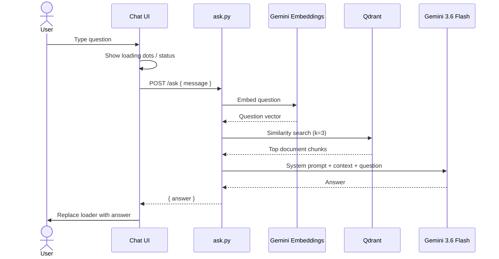

# FxHive RAG

A **Retrieval-Augmented Generation (RAG)** app that answers questions from a company PDF using **LangChain**, **Google Gemini**, and docker based **Qdrant** .

Users ask questions in a ChatGPT-style UI. The system finds relevant PDF chunks, then Gemini answers **only from that context**.

---

## What this project does

| Step | Description |
|------|-------------|
| **Ingest** | Load PDF → split into chunks → embed → store in Qdrant |
| **Ask** | Question → embed → similarity search → top chunks → Gemini → answer |

---

## Tech stack

| Component | What we use | Why |
|-----------|-------------|-----|
| **Framework** | LangChain | Connect LLM to your PDF data |
| **Embeddings** | `gemini-embedding-001` | Turn text into vectors |
| **LLM** | `gemini-3.6-flash` | Generate the final answer |
| **Vector DB** | Qdrant (`localhost:6333`) | Store vectors + text + metadata |
| **PDF loader** | `PyPDFLoader` (LangChain + pypdf) | Extract text from PDF pages |
| **Splitter** | `RecursiveCharacterTextSplitter` | Chunk size `1000`, overlap `200` |
| **UI** | Python stdlib HTTP server | ChatGPT-like chat at port `7860` |
| **Config** | `.env` + `python-dotenv` | Holds `GOOGLE_API_KEY` |

### LangChain vs LangGraph (quick note)

- **LangChain** — framework to build LLM apps (GPT, Gemini, Claude, etc.). **Main job:** connect the LLM with your data and retrieve relevant information.
- **LangGraph** — builds **stateful, multi-step** AI workflows and agents. *(Not used in this project; listed for team clarity.)*

---

## Project structure

```text
fxhive-rag/
├── documents/
│   └── fxhive.pdf          # Source PDF (indexed into Qdrant)
├── ingest.py               # Index PDF → Qdrant
├── ask.py                  # Chat UI + RAG Q&A
├── requirements.txt        # Python dependencies
├── .env                    # GOOGLE_API_KEY (do not commit)
└── README.md
```

---

## Prerequisites

1. **Python 3.12+**
2. **Docker** (for Qdrant)
3. **Google AI API key** ([Google AI Studio](https://aistudio.google.com/apikey))

---

## Setup

### 1) Create virtual environment & install packages

```bash
python -m venv .venv

pip install -r requirements.txt
```

### 2) Add API key

Create a `.env` file in the project root:

```env
GOOGLE_API_KEY=your_google_api_key_here
```

> Never commit `.env` or share your real key in docs/chat.

### 3) Start Qdrant

```bash
docker run -d --name fxhive-qdrant -p 127.0.0.1:6333:6333 -v qdrant_storage:/qdrant/storage qdrant/qdrant
```

If the container already exists:

```bash
docker start fxhive-qdrant
```

Check: open [http://localhost:6333](http://localhost:6333) — you should see Qdrant info JSON.

---

## How to run

### Index the PDF

```bash
python ingest.py
```

Expected output (example):

```text
Pages loaded: ...
Chunks created: ...
PDF indexed successfully!
```

Re-run `ingest.py` whenever you replace/update `documents/fxhive.pdf`.  
Ingest **deletes and recreates** the `fxhive_documents` collection so the index stays clean.

### Ask questions (UI)

```bash
python ask.py
```

Then open:

**http://127.0.0.1:7860**

Type a question in the chat box. A loading indicator shows until the answer appears.

---

## End-to-end architecture



---

## Pipeline flow (ingest + ask)



Text form of the same flow:

```text
PDF  →  Load  →  Split  →  Embed  →  Qdrant
                                         ↑
Question → Embed → Similarity search → top chunks → Prompt + Gemini → Answer
                    (semantic search)
```

---

## Detailed step meanings



| Concept | Meaning in this project |
|---------|-------------------------|
| **Embeddings** | Turn text chunks (and the question) into numeric **vectors** |
| **Qdrant** | Vector database that stores **vectors + original text + metadata** |
| **Similarity search** | Finds chunks whose vectors are closest to the question vector |
| **RAG** | Retrieve relevant text first, then generate an answer from it |
| **Prompt rule** | Model must answer **only** from PDF context; otherwise say it could not find it |

---

## Sequence: what happens when you ask



---

## Configuration (current defaults)

| Setting | Value |
|---------|--------|
| PDF path | `documents/fxhive.pdf` |
| Collection | `fxhive_documents` |
| Qdrant URL | `http://localhost:6333` |
| Chunk size | `1000` |
| Chunk overlap | `200` |
| Top-k retrieved | `3` |
| Embedding model | `models/gemini-embedding-001` |
| Chat model | `gemini-3.6-flash` |
| UI URL | `http://127.0.0.1:7860` |

---

## Sample FxHive questions

Use these after indexing the leave/attendance PDF.

### Policy / fact questions

- What is the minimum number of productive work hours per day?
- How long can employees take breaks during the day?
- Which software is used to record attendance?
- How many earned leaves do employees get annually?
- How many casual leaves are provided annually?
- How many days in advance should planned leaves be communicated?
- What is the policy for leave spanning three or more days?
- How does the sandwich leave policy work?
- Can unused leaves be carried forward to the next year?
- Can employees encash their unused leaves?
- Who has the final authority to approve or reject leave requests?

### Scenario questions

- If I work 8 hours and take a 1-hour break, how long should I be in the office?
- If I take leave on Friday and Monday, what happens to Saturday and Sunday?
- If a holiday falls on Thursday and I take leave on Friday, how is that leave counted?
- If I have unused leaves at the end of December, can I carry them into January?
- If I am an intern, am I eligible for earned and casual leaves?
- If I need three days of vacation leave, how early should I inform my manager?

### Missing-information tests

These should typically get a **“could not find it”**-style answer if the PDF does not contain that policy:

- How many work-from-home days are allowed each month?
- What is the salary deduction for taking unauthorized leave?
- How many sick leaves are provided annually?
- What is the company's maternity leave policy?

---

## Troubleshooting

| Problem | Fix |
|---------|-----|
| `GOOGLE_API_KEY` missing | Add key to `.env` |
| Cannot connect to Qdrant | `docker start fxhive-qdrant` and check port `6333` |
| Old / wrong answers | Re-run `python ingest.py` after PDF change |
| UI not opening | Ensure `python ask.py` is running; open `http://127.0.0.1:7860` |
| Gemini 503 / high demand | Wait and retry; project uses `gemini-3.6-flash` for stability |


